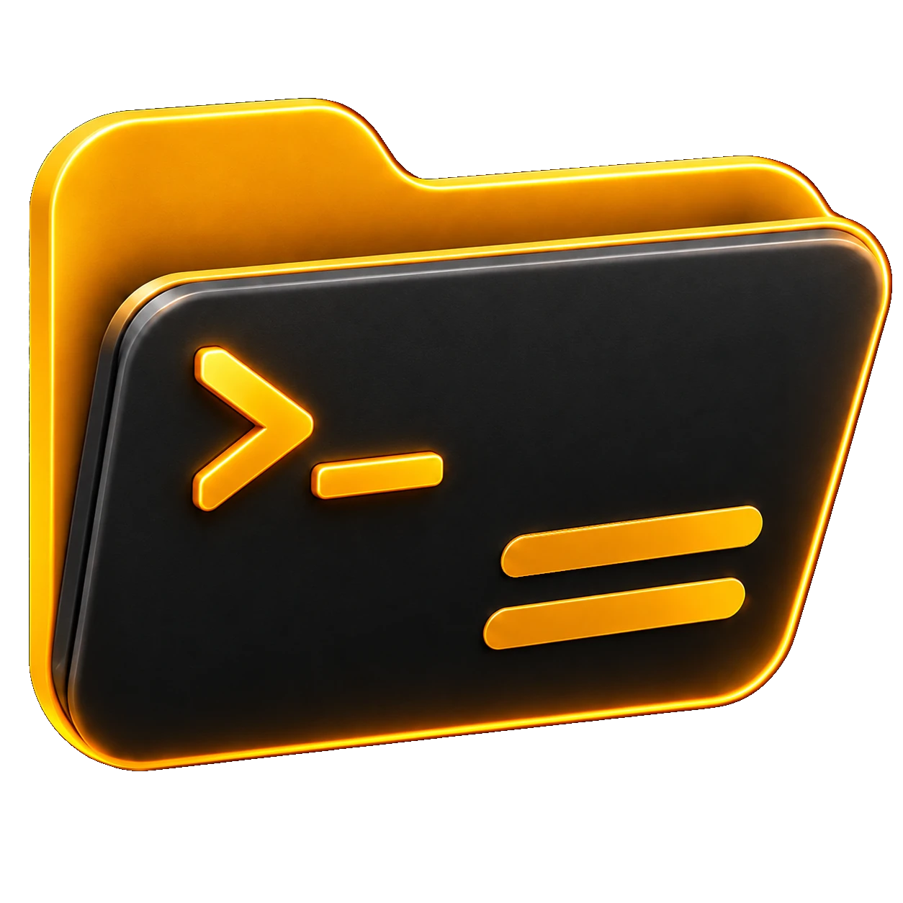
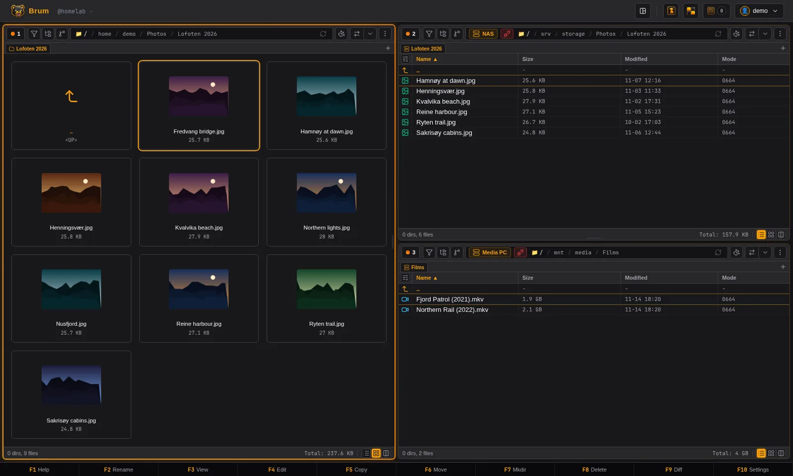
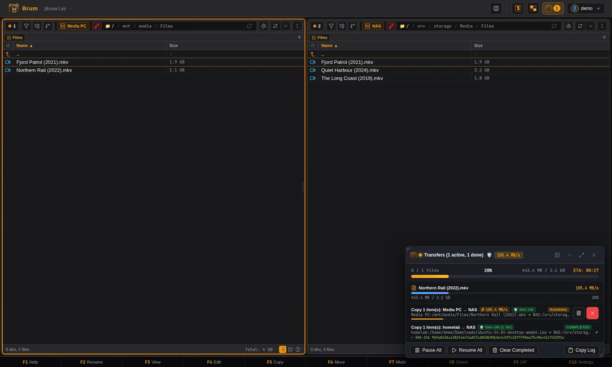
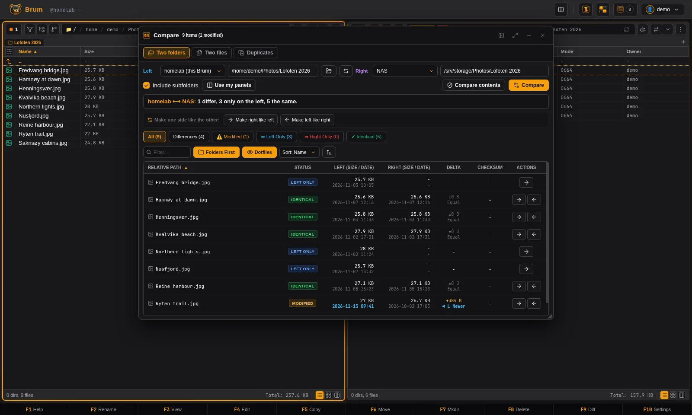
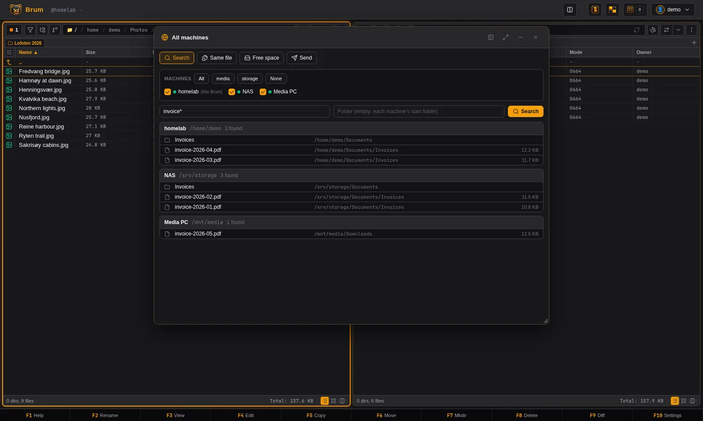
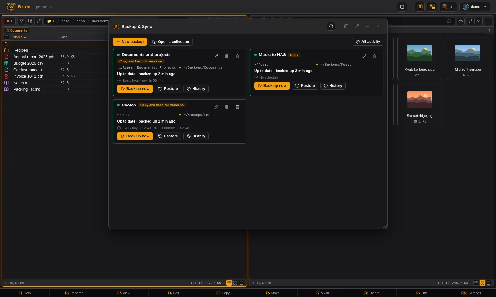
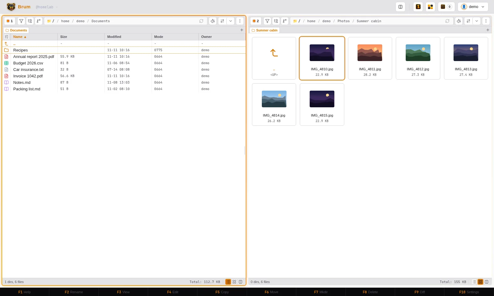
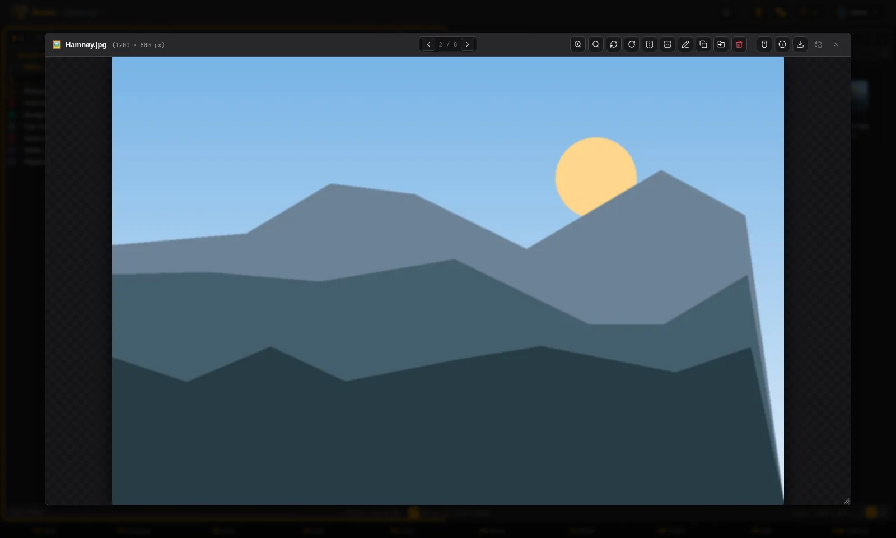
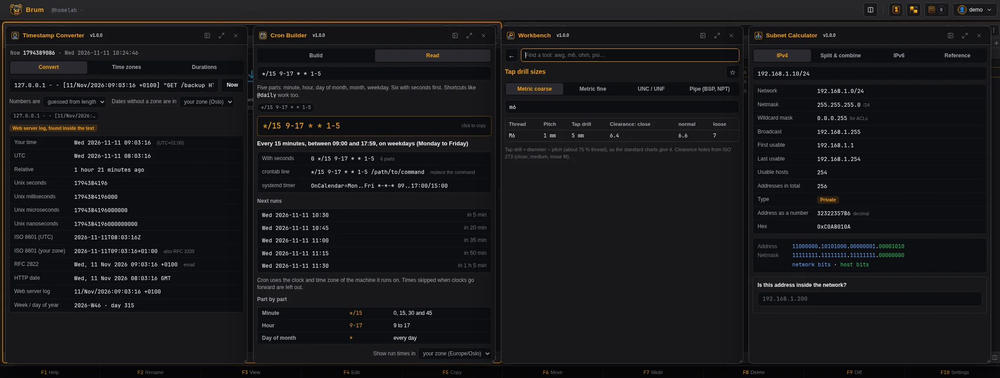
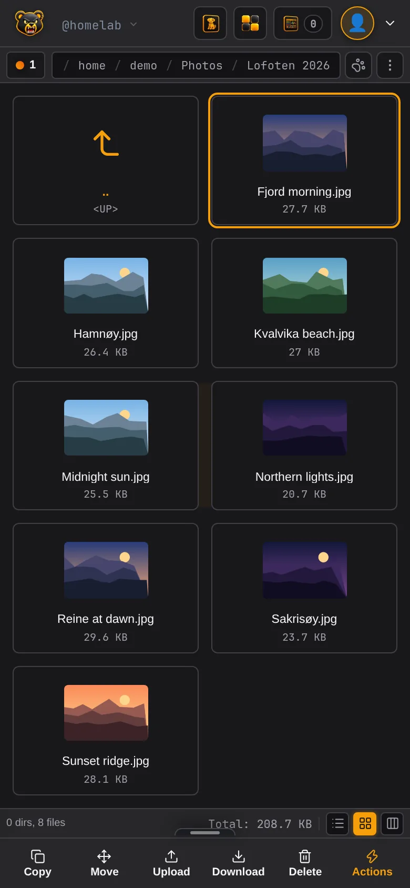

#  Brum

<div align="center">
  
  <p><em>All your machines, disks and cloud storage in one file manager — By Woofson</em></p>
  <p>
    <a href="https://github.com/Woofson/brum/releases/latest"></a>
    <a href="https://crates.io/crates/brum"></a>
    
    
    <a href="https://aur.archlinux.org/packages/brum"></a>
    <a href="https://ghcr.io/woofson/brum"></a>
    <a href="https://ko-fi.com/J7P327BXTR"></a>
  </p>
</div>

Install Brum on each of your machines (desktop, NAS, media PC, a server in a cupboard), join them with a pairing code, and every file on every one of them is a pane away. Next to your local disks, NAS shares and cloud storage, in the browser or as a desktop app.

---

> [!WARNING]
> **Network Security & Exposure Disclaimer**
> Brum is designed and intended to run on **local workstations, homelabs, and private overlay networks** (such as Tailscale, NetBird, or WireGuard).
>
> **Never expose Brum directly to the public internet.**
> As a comprehensive administrative environment featuring host filesystem management, integrated terminal PTY execution, and power tools, exposing Brum directly without a trusted VPN or authenticated overlay network introduces significant attack surface. If remote access is necessary, always access Brum through a private overlay mesh or an authenticated VPN. See the [Reverse Proxy & Mesh VPN Guide](manuals/reverse-proxy.md) for recommended deployment topologies. How security problems are reported and fixed: [Security](SECURITY.md).

---

## One place for all your machines

Brum calls your machines together a **Fleet**. Each machine runs its own Brum; the one you open in the browser reaches the others for you.

* **Any machine in any pane.** Open the NAS on the left and the media PC on the right, or four machines at once, with the same keys, tabs and tools as your own disks.
* **Copies straight from machine to machine.** <kbd>F5</kbd> and <kbd>F6</kbd> between two machines are done by the Brum servers, not the browser: the receiving machine fetches the files directly, and only when the two cannot reach each other does your Brum pass them along. Close the tab and the copy carries on.
* **Copies you can trust.** Every file is checked with SHA-256 on both machines before it replaces anything (on by default), a broken copy never overwrites a good file, and **Retry** picks up a large file where it stopped.
* **Compare and sync between machines.** Compare a folder on your desktop with its copy on the NAS, see what is missing or changed, preview what a one-way sync would do, and run it or save it as a scheduled backup.
* **All machines at once.** Search every machine for a file, check one file across all of them, see free space everywhere, and send files to several machines in one go. Group machines with tags to pick them quickly.
* **Joining takes a code, not a password.** Your main Brum shows a code that works once, for ten minutes; type it on the new machine and the two trust each other. No secrets copied around by hand.
* **Who can touch what, and who did.** Folder rules per machine (read only, no access, or open a folder to someone), and an activity log of who changed which files, with a CSV export.

**Not a server panel with a file tab.** Tools such as Cockpit or Webmin manage servers and include a file browser. Brum is the other way round: a full two-pane file manager whose job is your files, wherever they are, with server tools (terminal, log viewer, Git) added for convenience. It does not manage services, packages or users of the operating system.

<table>
  <tr>
    <td width="50%"><br><sub><b>Copies between machines.</b> Media PC to NAS, directly, with the speed, time left and a checksum check for every file.</sub></td>
    <td width="50%"><br><sub><b>Compare across machines.</b> A photo folder on this computer against its copy on the NAS, then make one side like the other.</sub></td>
  </tr>
  <tr>
    <td width="50%"><br><sub><b>All machines.</b> One search across every machine, grouped by machine; open any hit in a pane.</sub></td>
    <td width="50%"><br><sub><b>Backup &amp; Sync.</b> Scheduled backups to other Fleet machines, drives, SFTP, rclone remotes and Proton Drive, with old versions kept and restore.</sub></td>
  </tr>
</table>

To set up a main Brum and two more machines, see [Several machines in ten minutes](#several-machines-in-ten-minutes).

---

## Why Brum?

Beyond the Fleet, Brum is a file manager you use in the browser, written in Rust. It follows the classic two-pane style of Total Commander and Midnight Commander, so the keyboard does most of the work, and adds a set of everyday tools (see [Built-in Tools](#built-in-tools)).

* **Up to four panes**, each with its own tabs. Copy, move and compare between them with the classic <kbd>F1</kbd>–<kbd>F10</kbd> keys, drag and drop, or touch.
* **Local and remote storage in one view**: your disks and USB drives next to SFTP, SMB, WebDAV, S3, NFS, Proton Drive, and Jottacloud, Google Drive, OneDrive, Dropbox and many more cloud services through rclone. You can also browse inside archives and disk images.
* **Several users**, each limited to their own folders, with optional read-only accounts and sign-in through your own identity provider (OIDC).
* **Runs where you need it**: as a desktop app on Linux and Windows, in Docker on a server or NAS, or as a background service.

---

## Showcase

<table>
  <tr>
    <td width="50%"><br><sub><b>Two themes.</b> Woofsons Amber Charcoal and Woofsons Amber Zink (shown), with list, grid and column views.</sub></td>
    <td width="50%"><br><sub><b>Viewers.</b> Pictures, documents, audio and video open in place, with the next file one key away.</sub></td>
  </tr>
</table>

<p align="center">
  <br>
  <sub><b>Chewtoys.</b> Small add-ons in their own windows: Timestamp Converter, Cron Builder, Workbench and Subnet Calculator, among others.</sub>
</p>

<p align="center">
  <br>
  <sub><b>On the phone.</b> One panel at a time, with the main actions at your thumb.</sub>
</p>

---

## Quick Start

### Docker
```bash
docker run -d \
  --name brum \
  -p 3140:3140 \
  -v ./data:/data \
  -v /home:/mnt/home:rw \
  --restart unless-stopped \
  ghcr.io/woofson/brum:latest
```

### Arch Linux / CachyOS (AUR)
```bash
yay -S brum        # or: paru -S brum
```

### Cargo / Local Build
```bash
cargo run --release        # Open http://localhost:3140 in your browser
```

> [!NOTE]
> **Administrative Credentials & Initial Setup**:
> On first run with an uninitialized database, Brum dynamically generates a high-entropy random 20-character password for the `admin` account and outputs it to the server console (as well as `docker logs brum`) and to a one-time `initial_admin_credentials.txt` next to the database. At the first sign-in Brum asks you to choose your own password.
> - **Desktop & Standalone**: Standalone desktop mode (`brum` / `brum -s`) automatically authorizes the active local operating system user without requiring a password.
> - **Linux Host Accounts (PAM)**: When running on Linux, any valid local system account can log in directly via PAM.
> - **Existing Databases**: Upgrades and existing installations retain their previously configured passwords.

### Several machines in ten minutes

A main Brum (the one you open in the browser) and two more machines, for example a NAS and a media PC:

1. **Install Brum on all three** (any of the ways above). Brum listens on the network by default; if you changed that, set **Can be opened from** back to **Every network this machine is on** in **Admin Control Panel → Server Settings** (or the machine's overlay address, such as its Tailscale or NetBird IP), then restart it.
2. **Make a code on the main Brum**: sign in as admin, click the machine name at the top left (**Fleet Control**) → **Manage Fleet** → **Add machine**. Brum shows a code such as `9WBN-C4C7` that works once, for ten minutes, together with the command to run.
3. **Join from the NAS**: run `sudo brum join http://main-brum:3140 9WBN-C4C7 --name nas` and restart Brum there. Or open Brum on the NAS and use **Manage Fleet** → **Join a Fleet**, which restarts by itself.
4. **Repeat for the media PC** with a new code.
5. **Use them**: on the main Brum, the paw button in a pane's toolbar (**Places & Fleet**) lists your machines; pick one to open it in that pane. **Tools → All machines** searches all three at once.

People need an account with the same name on each machine they use. Details, including what to know about trust and unencrypted networks: [Several machines (Fleet)](manuals/fleet.md).

---

## Built-in Tools

Everything below ships inside the single Brum program. Tools that rely on a program installed on the server say so.

**Files & folders**

| Tool | What it does |
| :--- | :--- |
| **Search** | Find files by name, pattern or size, across folders. |
| **Compare** | Compare two folders (including subfolders) or two files side by side, copy differences across, and find duplicate files to clean up. |
| **Batch Renamer** | Rename many files at once: find and replace, regex, numbering, upper/lower case. |
| **Disk Usage** | See which folders and files take up the most space. |
| **Trash** | Deleted files go to the standard Linux trash and can be restored. |
| **Splitter & Combiner** | Split large files into parts and join them again, with checksum checks. |
| **Hex Editor** | View and edit a file byte by byte. |
| **Encrypted Vaults** | Password-protected containers (AES-256-GCM), opened in memory only. |

**Sharing & backup**

| Tool | What it does |
| :--- | :--- |
| **Sharing** | Public links to files or folders, with optional password, expiry date and upload drop box. |
| **Backup & Sync** | Scheduled backups of one or more folders to drives, NAS shares, SFTP, rclone remotes or other Brum machines, with old versions, preview, restore and per-file logs. |
| **Syncthing** | See the status of Syncthing on the server and start folder rescans. |

**Media & documents**

| Tool | What it does |
| :--- | :--- |
| **Media Player** | Audio and video, including tracker, chiptune and MIDI music, with playlists and subtitles. |
| **Tag Editor** | Edit music tags and album art; view photo EXIF data. |
| **PDF Studio** | Merge, split, reorder, rotate and extract PDF pages. |
| **Format Converter** | Convert images, audio and video (needs ImageMagick or FFmpeg on the server), and JSON/TOML/YAML files. |
| **3D Model Viewer** | View STL, OBJ, PLY and DXF files, with a cross-section view. STEP and IGES show as a rough outline. Viewing only. |
| **Notes** | Markdown notes with checklists, templates, version history and optional encryption. |

**Working on the server**

| Tool | What it does |
| :--- | :--- |
| **Terminal** | A shell in the browser, with tabs, as a slide-up panel or docked in a pane. |
| **Editor** | Multi-tab text and code editor. |
| **Log Viewer** | Follow a log file live, with filters. |
| **Git** | Status, stage, commit, push and pull for a repository. |
| **Calculator** | Includes storage units and conversions. |

**Chewtoys** are small add-ons that run in a sandbox. Brum comes with **Tetrion**, a block-puzzle game, and you can add your own (see the [Chewtoys manual](manuals/chewtoys.md)).

---

## Documentation & User Manuals

All operational runbooks, platform guides, and security manuals are available on the [**Official GitHub Wiki**](https://github.com/Woofson/brum/wiki) and organized in [**`manuals/`**](manuals/README.md):

* [**Several machines (Fleet)**](manuals/fleet.md) — Setting up a main Brum and more machines, pairing codes, copies, compare and sync, All machines, folder rules, activity log.
* [**Power Tools & Chewtoys Manual**](manuals/chewtoys.md) — 3D CAD Studio, Splitter & Combiner, PDF Studio, Sharing Center, Disk Usage, Notes, Media Player, Terminal, Vaults.
* [**Keyboard Shortcuts & Navigation**](manuals/shortcuts.md) — Orthodox <kbd>F1</kbd>–<kbd>F10</kbd> keys, media player keys, touch gestures.
* [**Settings and Configuration**](manuals/configuration.md) — Server Settings, what stays in `config.toml`, and every setting with its default.
* [**Remote Protocols & VFS Guide**](manuals/protocols.md) — SFTP, SMB, NFS, WebDAV, S3, Proton Drive, Hetzner.
* [**Cloud Storage (rclone)**](manuals/cloud-storage.md) — Jottacloud, Google Drive, OneDrive, Dropbox and more in panes and backups.
* [**Transparent Encrypted Vaults Guide**](manuals/vaults.md) — Argon2id + AES-256-GCM in-memory containers.
* [**Advanced Sharing & Client Portals**](manuals/sharing.md) — Public links, granular ACLs, dynamic watermarking, upload dropzones.
* [**Windows Desktop & Packaging**](manuals/windows.md) — Winget, Scoop, NSIS Setup, MSI, and Portable ZIP.
* [**Docker Deployment Guide**](manuals/docker.md) — Compose, Portainer, and volume persistence.
* [**Proxmox VE & LXC Containers**](manuals/lxc-proxmox.md) — 1-click Debian LXC container setup.
* [**Reverse Proxy & Mesh VPN Guide**](manuals/reverse-proxy.md) — Tailscale, NetBird, Caddy 2, Nginx, Traefik, Cloudflare.
* [**GitHub Milestones & Roadmap**](https://github.com/Woofson/brum/milestones) — Active milestones, roadmap vision, and release targets.
* [**GitHub Issues & Sprint Backlog**](https://github.com/Woofson/brum/issues) — Feature backlog, bug triage, and active sprint items.
* [**Changelog**](CHANGELOG.md) — Release notes and version history.
* [**Security**](SECURITY.md) — How to report a security problem, and every published advisory with the version that fixed it.

---

## Support & Contributions

I am very humbled for your support. If you find Brum worthy of a ko-fi, I would be very very grateful. Thank you.

[](https://ko-fi.com/J7P327BXTR)

---

## License

MIT, see [LICENSE](LICENSE). Copyright (c) 2026 Bolt J Woofson.

