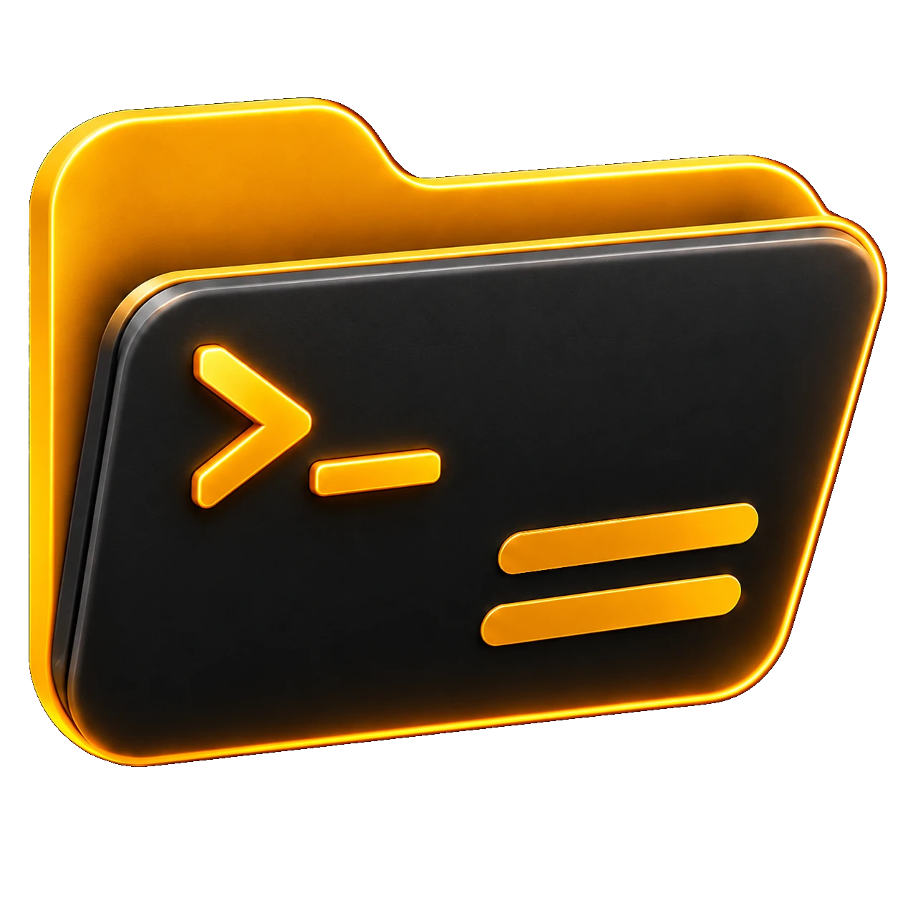
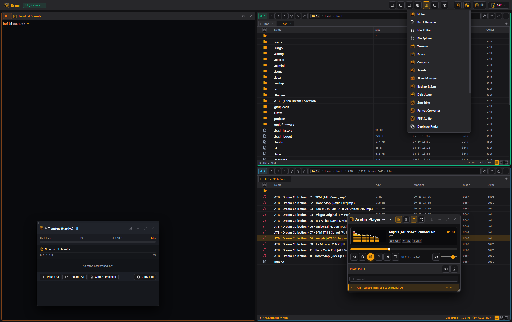

#  Brum

<div align="center">
  
  <p><em>Multi-Pane Web Environment (File Commander/Manager) — By Woofson</em></p>
  <p>
    <a href="https://github.com/Woofson/brum/releases/latest"></a>
    <a href="https://crates.io/crates/brum"></a>
    
    
    <a href="https://aur.archlinux.org/packages/brum"></a>
    <a href="https://ghcr.io/woofson/brum"></a>
    <a href="https://ko-fi.com/J7P327BXTR"></a>
  </p>
</div>

---

> [!WARNING]
> **Network Security & Exposure Disclaimer**
> Brum is designed and intended to run on **local workstations, homelabs, and private overlay networks** (such as Tailscale, NetBird, or WireGuard).
>
> **Never expose Brum directly to the public internet.**
> As a comprehensive administrative environment featuring host filesystem management, integrated terminal PTY execution, and power tools, exposing Brum directly without a trusted VPN or authenticated overlay network introduces significant attack surface. If remote access is necessary, always access Brum through a private overlay mesh or an authenticated VPN. See the [Reverse Proxy & Mesh VPN Guide](manuals/reverse-proxy.md) for recommended deployment topologies.

---

## Why Brum?

Brum is a fast, multi-pane file management environment built in Rust. It combines the keyboard precision and speed of classic orthodox file managers with a modern web and desktop workspace:

* **Side-by-Side Multi-Pane Browsing**: Work across 1 to 4 customizable panels (`Alt+1`–`4`) simultaneously. Move, copy, and compare files effortlessly using orthodox keyboard shortcuts (<kbd>F1</kbd>–<kbd>F10</kbd>), drag-and-drop, or touch controls.
* **Built-in Power Tools Suite**: Everything you need is integrated directly into the workspace—no extra software required. Edit PDFs, inspect disk usage, batch rename files, play audio and video, view logs in real time, compare diffs, split large files, and launch a persistent terminal.
* **Unified Local & Remote Storage**: Browse local disks, USB drives, and remote infrastructure in the same view. Connect directly to SFTP/SSH, SMB/Windows shares, WebDAV, S3 buckets, and NFS without mounting external filesystems.
* **Direct File Sharing**: Create password-protected public share links with expiration rules and client upload dropzones straight from your browser—no third-party cloud subscription required.
* **Encrypted Virtual Vaults**: Secure sensitive personal or corporate files inside encrypted vault containers that stream directly through RAM, ensuring unencrypted files never touch disk.
* **Multi-Node Fleet Management**: Connect and monitor multiple Brum servers across your home lab, office network, or cloud VPS from a single unified web dashboard.
* **Lightweight & Runs Anywhere**: Deploy as a standalone desktop app on Linux and Windows, self-host with Docker on a server or NAS, or run headless as a background system service with minimal resource usage.

---

## Quick Start

### Docker
```bash
docker run -d \
  --name brum \
  -p 3140:3140 \
  -v ./data:/data \
  -v /home:/mnt/home:rw \
  --restart unless-stopped \
  ghcr.io/woofson/brum:latest
```

### Arch Linux / CachyOS (AUR)
```bash
yay -S brum        # or: paru -S brum
```

### Cargo / Local Build
```bash
cargo run --release        # Open http://localhost:3140 in your browser
```

> [!NOTE]
> **Administrative Credentials & Initial Setup**:
> On first run with an uninitialized database, Brum dynamically generates a high-entropy random 20-character password for the `admin` account and outputs it to the server console (as well as `docker logs brum` or the logging directory).
> - **Desktop & Standalone**: Standalone desktop mode (`brum` / `brum -s`) automatically authorizes the active local operating system user without requiring a password.
> - **Linux Host Accounts (PAM)**: When running on Linux, any valid local system account can log in directly via PAM.
> - **Existing Databases**: Upgrades and existing installations retain their previously configured passwords.

---

## Built-in Native Core Functions & Chewtoys Suite

| Core Function | Description | Replaced Utility |
| :--- | :--- | :--- |
| **3D CAD Studio** | Interactive 3D model & mesh viewer (STL, OBJ, DXF, PLY, STEP wireframe, slicing plane) | Blender / MeshLab / FreeCAD |
| **File Splitter & Combiner** | Chunk-based binary file splitting, MD5/SHA-256 integrity checks, and recombining | HJSplit / GSplit / 7-Zip |
| **PDF Studio** | Pure-Rust visual PDF page reordering, splitting, 90° rotation, page extraction & merger | PDFsam / Acrobat |
| **Sharing Center** | Public file & folder link sharing, passcodes, expiration rules, client upload dropzones | Nextcloud Share / Dropbox |
| **Disk Usage Analyzer** | Interactive disk usage analyzer, directory distribution bar charts & top files inspector | WinDirStat / Baobab / ncdu |
| **Notes** | SQLite-backed Markdown notebook, checklists, version snapshots, and encrypted notes | Obsidian / Joplin |
| **Media Player** | Multi-format audio & video player, chiptune/tracker/MIDI synth, visualizer, playlists & background pill | VLC / MPC-HC / Winamp |
| **Bite! Terminal** | Persistent slide-up WebSocket PTY terminal with bundled JetBrainsMono Nerd Fonts | PuTTY / Web SSH |
| **XDG Trash Suite** | Linux XDG specification-compliant trash bin, `.trashinfo` metadata & 1-click restore | trash-cli / Recycle Bin |
| **Duplicate Finder** | Multi-stage hash scanner (Blake3, SHA-256, MD5) with smart cleanup and filters | Czkawka / DupeGuru |
| **Batch Renamer** | Multi-pattern regex substitutions, auto-numbering, prefix/suffix, case transformations | Advanced Renamer |
| **Hex Editor** | Hexadecimal & ASCII binary byte inspector with search, jump to offset, and in-place editing | HxD / Hex Fiend |
| **Tag Editor & EXIF** | Audio ID3v1/ID3v2 metadata & album art editor, sequential auto-numberer & EXIF inspector | Mp3tag / ExifTool |
| **Log Viewer** | Real-time log tailing, regex & inverted filters, log level parsing, and autoscroll | lnav / tail -f |
| **Format Converter** | Browser-native image, audio, video, and document format transcoding | HandBrake / CloudConvert |
| **Sync & Replication** | Block-level binary delta replication (4 profiles), scheduler, and webhooks | Bvckup 2 / SyncToy |
| **Encrypted Vaults** | Zero-leakage AES-256-GCM in-memory encrypted virtual filesystem containers | Cryptomator / VeraCrypt |
| **Diff & Comparison** | Side-by-side text/code diffs and cryptographic directory comparison matrix | Beyond Compare / WinMerge |
| **Tetrion (Chewtoy)** | 60 FPS arcade canvas game, SRS rotation, DAS/ARR tuning & sync leaderboard | Desktop Distractions |

---

## Documentation & User Manuals

All operational runbooks, platform guides, and security manuals are available on the [**Official GitHub Wiki**](https://github.com/Woofson/brum/wiki) and organized in [**`manuals/`**](manuals/README.md):

* [**Power Tools & Chewtoys Manual**](manuals/chewtoys.md) — 3D CAD Studio, Splitter & Combiner, PDF Studio, Sharing Center, Disk Usage, Notes, Media Player, Terminal, Vaults.
* [**Keyboard Shortcuts & Navigation**](manuals/shortcuts.md) — Orthodox <kbd>F1</kbd>–<kbd>F10</kbd> keys, media player keys, touch gestures.
* [**Configuration Guide (`config.toml`)**](manuals/configuration.md) — Master config options, storage roots, sandboxing.
* [**Remote Protocols & VFS Guide**](manuals/protocols.md) — SFTP, SMB, NFS, WebDAV, S3, Proton Drive, Hetzner.
* [**Transparent Encrypted Vaults Guide**](manuals/vaults.md) — Argon2id + AES-256-GCM in-memory containers.
* [**Advanced Sharing & Client Portals**](manuals/sharing.md) — Public links, granular ACLs, dynamic watermarking, upload dropzones.
* [**Windows Desktop & Packaging**](manuals/windows.md) — Winget, Scoop, NSIS Setup, MSI, and Portable ZIP.
* [**Docker Deployment Guide**](manuals/docker.md) — Compose, Portainer, and volume persistence.
* [**Proxmox VE & LXC Containers**](manuals/lxc-proxmox.md) — 1-click Debian LXC container setup.
* [**Reverse Proxy & Mesh VPN Guide**](manuals/reverse-proxy.md) — Tailscale, NetBird, Caddy 2, Nginx, Traefik, Cloudflare.
* [**GitHub Milestones & Roadmap**](https://github.com/Woofson/brum/milestones) — Active milestones, roadmap vision, and release targets.
* [**GitHub Issues & Sprint Backlog**](https://github.com/Woofson/brum/issues) — Feature backlog, bug triage, and active sprint items.
* [**Changelog**](CHANGELOG.md) — Release notes and version history.

---

## Support & Contributions

If you find **Brum** useful and would like to support ongoing development, consider buying a coffee:

[](https://ko-fi.com/J7P327BXTR)

---

## License

MIT License © [Bolt J Woofson](https://www.arf.ac) @ Woofsons Lab

