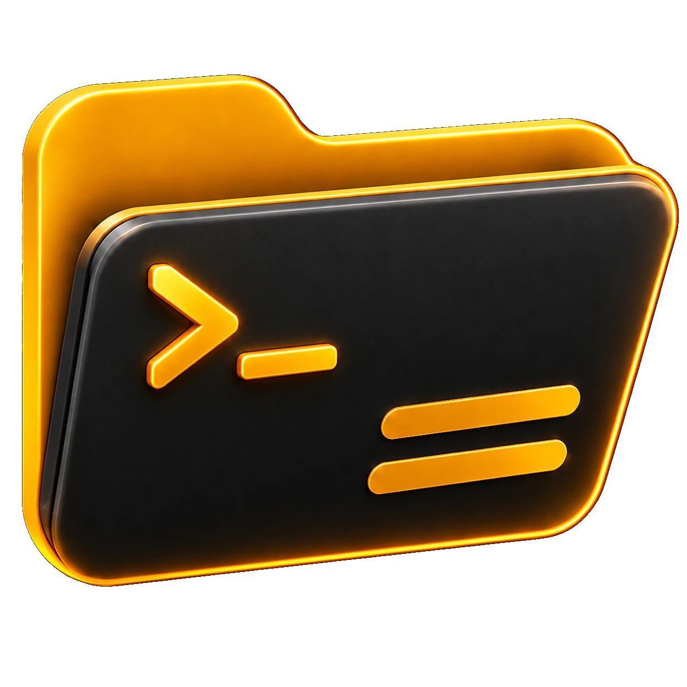
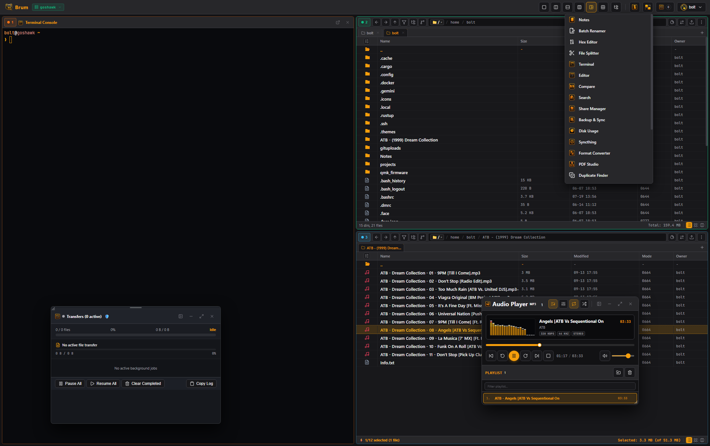

#  Brum

<div align="center">
  
  <p><em>Multi-Pane Web Environment (File Commander/Manager) — By Woofson</em></p>
  <p>
    <a href="https://github.com/Woofson/brum/releases/latest"></a>
    <a href="https://crates.io/crates/brum"></a>
    
    
    <a href="https://aur.archlinux.org/packages/brum"></a>
    <a href="https://ghcr.io/woofson/brum"></a>
    <a href="https://ko-fi.com/J7P327BXTR"></a>
  </p>
</div>

---

> [!WARNING]
> **Network Security & Exposure Disclaimer**
> Brum is designed and intended to run on **local workstations, homelabs, and private overlay networks** (such as Tailscale, NetBird, or WireGuard).
>
> **Never expose Brum directly to the public internet.**
> As a comprehensive administrative environment featuring host filesystem management, integrated terminal PTY execution, and power tools, exposing Brum directly without a trusted VPN or authenticated overlay network introduces significant attack surface. If remote access is necessary, always access Brum through a private overlay mesh or an authenticated VPN. See the [Reverse Proxy & Mesh VPN Guide](manuals/reverse-proxy.md) for recommended deployment topologies.

---

## Why Brum?

Brum is a file manager you use in the browser, written in Rust. It follows the classic two-pane style of Total Commander and Midnight Commander, so the keyboard does most of the work, and adds a set of everyday tools (see [Built-in Tools](#built-in-tools)).

* **Up to four panes**, each with its own tabs. Copy, move and compare between them with the classic <kbd>F1</kbd>–<kbd>F10</kbd> keys, drag and drop, or touch.
* **Local and remote in one view**: your disks and USB drives next to SFTP, SMB, WebDAV, S3, NFS and Proton Drive. You can also browse inside archives and disk images.
* **Several users**, each limited to their own folders, with optional read-only accounts and sign-in through your own identity provider (OIDC).
* **Fleet**: manage other Brum servers from the same window.
* **Runs where you need it**: as a desktop app on Linux and Windows, in Docker on a server or NAS, or as a background service.

---

## Quick Start

### Docker
```bash
docker run -d \
  --name brum \
  -p 3140:3140 \
  -v ./data:/data \
  -v /home:/mnt/home:rw \
  --restart unless-stopped \
  ghcr.io/woofson/brum:latest
```

### Arch Linux / CachyOS (AUR)
```bash
yay -S brum        # or: paru -S brum
```

### Cargo / Local Build
```bash
cargo run --release        # Open http://localhost:3140 in your browser
```

> [!NOTE]
> **Administrative Credentials & Initial Setup**:
> On first run with an uninitialized database, Brum dynamically generates a high-entropy random 20-character password for the `admin` account and outputs it to the server console (as well as `docker logs brum`) and to a one-time `initial_admin_credentials.txt` next to the database.
> - **Desktop & Standalone**: Standalone desktop mode (`brum` / `brum -s`) automatically authorizes the active local operating system user without requiring a password.
> - **Linux Host Accounts (PAM)**: When running on Linux, any valid local system account can log in directly via PAM.
> - **Existing Databases**: Upgrades and existing installations retain their previously configured passwords.

---

## Built-in Tools

Everything below ships inside the single Brum program. Tools that rely on a program installed on the server say so.

**Files & folders**

| Tool | What it does |
| :--- | :--- |
| **Search** | Find files by name, pattern or size, across folders. |
| **Compare** | Compare two files or two folders side by side. |
| **Duplicate Finder** | Find identical files (size, then SHA-256) and move the extras to a quarantine folder. |
| **Batch Renamer** | Rename many files at once: find and replace, regex, numbering, upper/lower case. |
| **Disk Usage** | See which folders and files take up the most space. |
| **Trash** | Deleted files go to the standard Linux trash and can be restored. |
| **Splitter & Combiner** | Split large files into parts and join them again, with checksum checks. |
| **Hex Editor** | View and edit a file byte by byte. |
| **Encrypted Vaults** | Password-protected containers (AES-256-GCM), opened in memory only. |

**Sharing & backup**

| Tool | What it does |
| :--- | :--- |
| **Sharing** | Public links to files or folders, with optional password, expiry date and upload drop box. |
| **Backup & Sync** | Copy or mirror folders on a schedule, sending only the changed parts of files. |
| **Syncthing** | See the status of Syncthing on the server and start folder rescans. |

**Media & documents**

| Tool | What it does |
| :--- | :--- |
| **Media Player** | Audio and video, including tracker, chiptune and MIDI music, with playlists and subtitles. |
| **Tag Editor** | Edit music tags and album art; view photo EXIF data. |
| **PDF Studio** | Merge, split, reorder, rotate and extract PDF pages. |
| **Format Converter** | Convert images, audio and video (needs ImageMagick or FFmpeg on the server), and JSON/TOML/YAML files. |
| **3D Model Viewer** | View STL, OBJ, PLY and DXF files, with a cross-section view. STEP and IGES show as a rough outline. Viewing only. |
| **Notes** | Markdown notes with checklists, templates, version history and optional encryption. |

**Working on the server**

| Tool | What it does |
| :--- | :--- |
| **Terminal** | A shell in the browser, with tabs, as a slide-up panel or docked in a pane. |
| **Editor** | Multi-tab text and code editor. |
| **Log Viewer** | Follow a log file live, with filters. |
| **Git** | Status, stage, commit, push and pull for a repository. |
| **Calculator** | Includes storage units and conversions. |

**Chewtoys** are small add-ons that run in a sandbox. Brum comes with **Tetrion**, a block-puzzle game, and you can add your own (see the [Chewtoys manual](manuals/chewtoys.md)).

---

## Documentation & User Manuals

All operational runbooks, platform guides, and security manuals are available on the [**Official GitHub Wiki**](https://github.com/Woofson/brum/wiki) and organized in [**`manuals/`**](manuals/README.md):

* [**Power Tools & Chewtoys Manual**](manuals/chewtoys.md) — 3D CAD Studio, Splitter & Combiner, PDF Studio, Sharing Center, Disk Usage, Notes, Media Player, Terminal, Vaults.
* [**Keyboard Shortcuts & Navigation**](manuals/shortcuts.md) — Orthodox <kbd>F1</kbd>–<kbd>F10</kbd> keys, media player keys, touch gestures.
* [**Configuration Guide (`config.toml`)**](manuals/configuration.md) — Master config options, storage roots, sandboxing.
* [**Remote Protocols & VFS Guide**](manuals/protocols.md) — SFTP, SMB, NFS, WebDAV, S3, Proton Drive, Hetzner.
* [**Transparent Encrypted Vaults Guide**](manuals/vaults.md) — Argon2id + AES-256-GCM in-memory containers.
* [**Advanced Sharing & Client Portals**](manuals/sharing.md) — Public links, granular ACLs, dynamic watermarking, upload dropzones.
* [**Windows Desktop & Packaging**](manuals/windows.md) — Winget, Scoop, NSIS Setup, MSI, and Portable ZIP.
* [**Docker Deployment Guide**](manuals/docker.md) — Compose, Portainer, and volume persistence.
* [**Proxmox VE & LXC Containers**](manuals/lxc-proxmox.md) — 1-click Debian LXC container setup.
* [**Reverse Proxy & Mesh VPN Guide**](manuals/reverse-proxy.md) — Tailscale, NetBird, Caddy 2, Nginx, Traefik, Cloudflare.
* [**GitHub Milestones & Roadmap**](https://github.com/Woofson/brum/milestones) — Active milestones, roadmap vision, and release targets.
* [**GitHub Issues & Sprint Backlog**](https://github.com/Woofson/brum/issues) — Feature backlog, bug triage, and active sprint items.
* [**Changelog**](CHANGELOG.md) — Release notes and version history.

---

## Support & Contributions

If you find **Brum** useful and would like to support ongoing development, consider buying a coffee:

[](https://ko-fi.com/J7P327BXTR)

---

## License

MIT License © [Bolt J Woofson](https://www.arf.ac) @ Woofsons Lab

