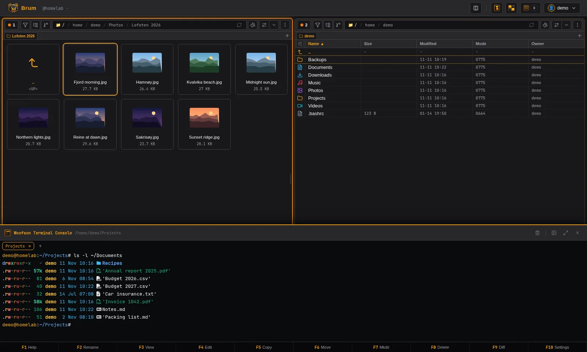

# Brum for Windows

<div align="center">
  
</div>

> **Multi-Panel File Commander for Web & Windows**  
> *Engineered in Rust — High-Performance, Low Memory, Zero Electron Overhead.*

---

## 1. Overview & Architecture

Brum on Windows is distributed as a unified single binary (`brum.exe`):
1. **Interactive Desktop Mode (`brum.exe -s` or `brum.exe --standalone`)**:
   - Launches the local server with one-time desktop auto-authentication and immediately opens the user interface in your default browser or PWA window.
   - Ultra-fast startup, ~30MB RAM idle consumption, full hardware-accelerated rendering in modern browsers (Edge, Chrome, Firefox).
   - Seamlessly compatible with browser application mode (`msedge.exe --app=http://127.0.0.1:3140` or `chrome.exe --app=http://127.0.0.1:3140`) for an isolated, borderless window.
2. **High-Performance Background & CLI Server (`brum.exe --server`)**:
   - Single-binary Axum async HTTP/WebSocket server.
   - Run as a headless background service, local server, or portable command-line tool.
   - Manages native Windows NT Services directly via `brum.exe --install-service`, `--start-service`, etc.

---

## 2. Installation Options

### A. Windows Package Manager (`winget`)
Install with a single command from PowerShell or Windows Terminal:
```powershell
winget install Woofson.Brum
```

### B. Scoop Package Manager
Install via Scoop bucket:
```powershell
scoop bucket add woofson https://github.com/Woofson/scoop-bucket.git
scoop install brum
```

### C. Inno Setup Windows Installer (`.exe`)
1. Download `Brum-Setup-v1.21.0.exe` from [GitHub Releases](https://github.com/Woofson/brum/releases).
2. Choose between **Desktop Mode** (browser / shortcut integration) or **Background Windows Service (SCM)** mode.
3. Automatically sets up Start Menu items, Desktop shortcuts, Context Menu integrations, and `%PROGRAMDATA%\Brum\` configuration roots.

### D. Zero-Install Standalone Portable ZIP
1. Download `brum-v1.21.0-windows-x86_64.zip` from [GitHub Releases](https://github.com/Woofson/brum/releases).
2. Extract anywhere (e.g. `C:\Tools\Brum` or a USB drive).
3. Run `brum.exe -s` (Desktop mode) or `brum.exe` — includes bundled `./themes/` folder and `config.toml`. The database and its key are saved next to `brum.exe`, so the whole folder can move.

---

## 3. Windows Service Architecture & SCM Management

Brum can run 24/7 as a background Windows Service managed by the native Windows Service Control Manager (SCM):

### Service Control Commands:
Run PowerShell or CMD as **Administrator**:
```powershell
# Install Brum as an auto-starting Windows Service
brum.exe --install-service

# Start the background service
brum.exe --start-service
# or: net start Brum

# Stop the service
brum.exe --stop-service
# or: net stop Brum

# Uninstall / remove the service registration
brum.exe --uninstall-service
```

### Windows Service Logging & Configuration:
* **Service Config**: `config.toml` in the install folder (e.g. `C:\Program Files\Brum\config.toml`). See [Which config.toml is used](#which-configtoml-is-used).
* **Database & Auth**: `%PROGRAMDATA%\Brum\brum.db`. This shared data folder is open only to the service and administrators. Versions before 1.21.1 kept the service's database in the install folder; Brum moves it here, with its key file, first-login note and Proton files, on the first start as the service or administrator.
* **Desktop mode** started by a user without administrator rights keeps its own data in that user's `%APPDATA%\Brum\` instead.
* **Event Logging**: SCM lifecycle events and errors are recorded directly in the Windows Application Event Log (`eventvwr.msc`).

---

## 4. First Login & Windows Accounts

### The first admin password
* The built-in username is **`admin`** (set by `default_admin_user` in `config.toml`).
* On the very first start, Brum makes up a random password. It is shown once in the console window (a background service has none) and saved to a note next to the database:
  `C:\ProgramData\Brum\initial_admin_credentials.txt`
* While that note exists, the login page shows where it is. The page never shows the password itself.
* The note stays until the `admin` password is changed in **Settings -> Security**. Logging in, including with a Windows administrator account, does not remove it.
* While the note exists, each start also writes its location to the log.

### Setting your own password in config.toml
* `default_admin_pass` in the `[auth]` section is used **only on the very first start**, when the user database is created. Changing it later has no effect; the log says so if it no longer matches.
* The value `brum` (the default) means "make one up".
* To choose your own first password on a fresh install: stop Brum, delete `C:\ProgramData\Brum\brum.db` (and `brum.db-shm` / `brum.db-wal` if present), set `default_admin_pass`, and start Brum again. This removes all Brum users and settings, so only do it on a fresh install.

### Lost the admin password
Run this on the Brum machine, in PowerShell or CMD **opened as administrator**. It finds the service's database from any folder. Without administrator rights it uses your own desktop-mode data instead, and says so. Adjust the path if Brum is installed elsewhere:
```powershell
& "C:\Program Files\Brum\brum.exe" reset-admin-password
```
With Scoop or the portable ZIP, `brum reset-admin-password` from the Brum folder works too.
It gives `admin` a new made-up password, prints it, and saves it to the same note. If the `admin` account was disabled, it is turned back on. Running it ends every login that account had open.

### Which config.toml is used
Brum reads the **first** of these that exists and ignores the rest:
1. The file named in the `BRUM_CONFIG` environment variable.
2. `%APPDATA%\brum\config.toml` (the settings folder of the Windows account running Brum).
3. `%LOCALAPPDATA%\brum\config.toml`.
4. `config.toml` next to `brum.exe` (the install folder).

The background service runs as the Windows system account, whose settings folder is `C:\Windows\System32\config\systemprofile\AppData\Roaming\brum\`. In practice the service uses the copy in the install folder. If an edit seems to be ignored, look for a copy higher up this list. The log shows which file was loaded (`Loading master configuration: ...`).

### Logging in with Windows accounts
With `mode = "mixed"` (the default), Windows accounts can log in with their Windows password:
* **Local accounts**: the account name, e.g. `alice`, or `.\alice` for this computer only.
* **Domain accounts**: `DOMAIN\alice`.
* **Microsoft online accounts**: the full address, e.g. `me@mail.com`, or `MicrosoftAccount\me@mail.com`. Both reach the same Brum profile.
  * Use the Microsoft account **password**. A Windows Hello PIN, fingerprint or face is not a password and does not work here.
  * Accounts set to **passwordless** in the Microsoft account settings have no password Windows can check, so they cannot log in this way. Use the `admin` account or a local Windows account instead.
* Members of the Windows **Administrators** group become Brum admins.
* Every refused attempt is written to the log in `C:\ProgramData\Brum\logs\` with Windows' reason (for example "wrong username or password" or "account restriction"). The password is never logged.

---

## 5. Windows Explorer Context Menu Integration

Add **"Open in Brum"** to the Windows Explorer right-click context menu for any directory, drive, or folder background:

### Register Context Menu:
Double-click `packaging\windows\register-context-menu.reg` or run:
```powershell
reg import packaging\windows\register-context-menu.reg
```

### Unregister Context Menu:
Double-click `packaging\windows\unregister-context-menu.reg` or run:
```powershell
reg import packaging\windows\unregister-context-menu.reg
```

---

## 6. Windows Filesystem Features

- **Native Windows SAM Authentication (`LogonUserW`)**: Authenticate directly with local Windows accounts or domain credentials against the Windows Security Account Manager (SAM) with automatic `%USERPROFILE%` home directory mapping and Admin group detection.
- **Drive Letter Navigation**: Switch seamlessly across `C:\`, `D:\`, `E:\`, `Z:\` in breadcrumbs and the quick jump menu.
- **Environment Variable Expansion**: Navigate directly to `%USERPROFILE%`, `%APPDATA%`, `%LOCALAPPDATA%`, `%TEMP%`, or `~/`.
- **Windows SMB & UNC Paths**: Open and browse network shares transparently using UNC format (`\\server\share\folder`) or orthodox `smb://user@server/share`.
- **Windows Recycle Bin Restoration**: Direct integration with Windows Recycle Bin (`C:\$Recycle.Bin`), parsing `$I*` deletion metadata and restoring files to their original paths.
- **Integrated Windows PowerShell / CMD Terminal**: Embedded slide-up terminal console defaulting to Windows PowerShell or `COMSPEC` (`cmd.exe`).
- **Transparent Encrypted Vaults (`.cdvault`)**: Password-protected AES-256-GCM / Argon2id zero-knowledge virtual storage containers.

---

## 7. Windows PE Metadata & Build Inspection

Windows executable (`brum.exe`) automatically embeds PE Version Resources:
* **File Version**: Formatted as `MAJOR.MINOR.PATCH.BUILD` (e.g. `1.8.8.419`).
* **Product Version**: Formatted as full SemVer 2.0.0 metadata (e.g. `1.8.8+build.419.git.8f42092`).
* **File Properties**: Right-click `brum.exe` in Windows Explorer -> **Properties** -> **Details** tab to view the exact build number, product version, and lab copyright information.

---

## 8. Multimedia & Transcoding Dependencies (Format Converter)

Brum runs completely standalone out-of-the-box with zero mandatory runtime dependencies for file browsing, terminals, and encrypted vaults.

To enable full audio/video and image transcoding capabilities in the built-in **Format Converter (ConvertX)** Core Function on Windows, install `ffmpeg` and `ImageMagick`:

### 1-Command Installation via Package Managers

#### Via Windows Package Manager (`winget`):
```powershell
winget install Gyan.FFmpeg ImageMagick.ImageMagick
```

#### Via Scoop:
```powershell
scoop install ffmpeg imagemagick
```

#### Via Chocolatey:
```powershell
choco install ffmpeg imagemagick
```

### Manual Installation & PATH Setup
If installing manually without a package manager:
1. Download official static builds from [gyan.dev/ffmpeg/builds](https://www.gyan.dev/ffmpeg/builds/) or [ffmpeg.org](https://ffmpeg.org/download.html).
2. Download ImageMagick from [imagemagick.org](https://imagemagick.org/script/download.php#windows).
3. Extract and add the directory containing `ffmpeg.exe` and `magick.exe` to your Windows System `PATH` environment variable.
4. Restart Brum or open a new terminal session.

---

## 9. Building from Source on Windows

### Prerequisites
- [Rust & Cargo](https://rustup.rs/) (`stable-x86_64-pc-windows-msvc` or cross-compile with `x86_64-pc-windows-gnu`)
- Visual Studio 2022 C++ Build Tools or MinGW-w64 toolchain

### Cross-Compiling from Linux:
```bash
cargo build --release --target x86_64-pc-windows-gnu
```

### Native PowerShell Build Script:
```powershell
Set-ExecutionPolicy -Scope Process -ExecutionPolicy Bypass
.\packaging\windows\build-windows.ps1 -Release
```

Build outputs are placed in `dist\windows\`:
- `dist\windows\brum-v1.21.0-windows-x86_64.zip` (Portable Distribution)
- `dist\windows\Brum-Setup-v1.21.0.exe` (Inno Setup Installer)
- `dist\windows\SHA256SUMS.txt` (Integrity Hashes)

---

## License
MIT License — Copyright (c) 2026 Bolt J Woofson <bolt@boop.no>
